<h1 align="center">NoteLume · 文溯</h1>

<p align="center">
  为「嫌 <strong>Typora</strong> 没组织、嫌 <strong>Obsidian</strong> 太重」的人做的本地 Markdown 编辑器。<br>
  约 6 MB 的单体安装包，编辑手感第一；你的笔记就是一堆标准 <code>.md</code> 文件躺在自己的文件夹里：秒开、离线、零格式锁定。
</p>

<p align="center">
  <a href="https://github.com/HackerSnail/NoteLume"></a>
  <a href="https://github.com/HackerSnail/NoteLume/blob/master/LICENSE"></a>
  
</p>

<p align="center">
  <a href="#中文">中文</a> ·
  <a href="#english">English</a>
</p>

<table align="center">
  <tr>
    <td align="center">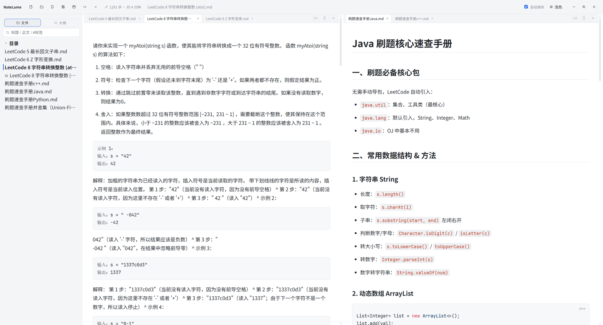<br>浅色</td>
    <td align="center">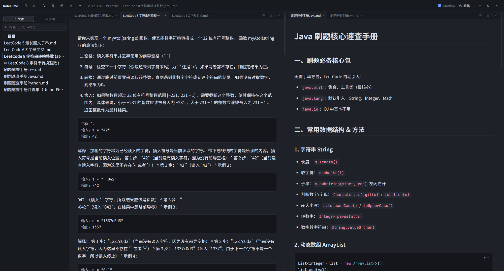<br>暗黑</td>
    <td align="center">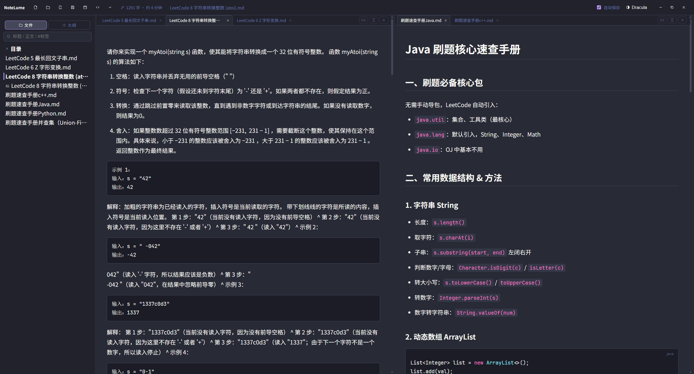<br>Dracula</td>
  </tr>
</table>

## 功能演示 · Feature demos

<table>
  <tr>
    <td width="50%" align="center"><br>所写即所得 · Live Markdown</td>
    <td width="50%" align="center">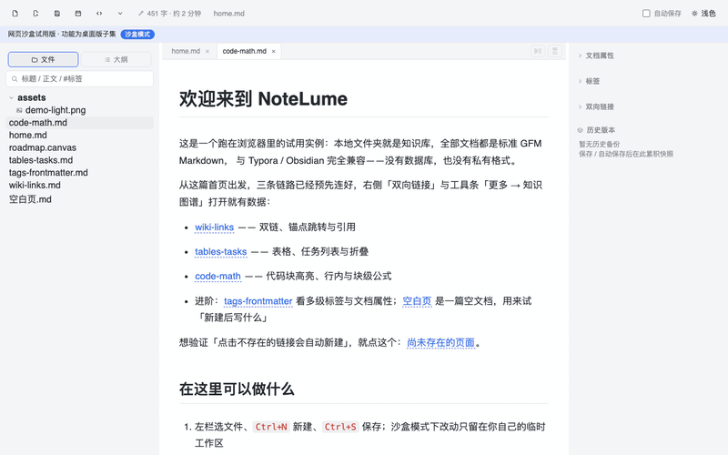<br>公式、图表、代码高亮就地渲染 · Rich rendering</td>
  </tr>
  <tr>
    <td align="center">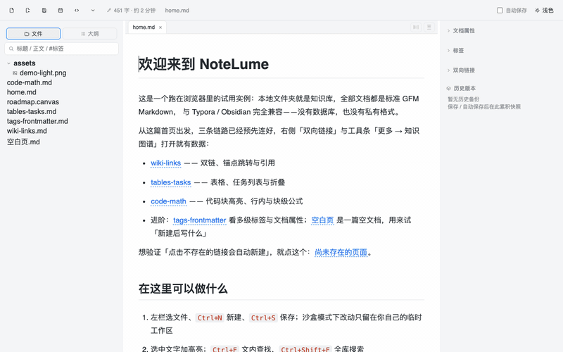<br>正文与 Markdown 源码互切 · Source toggle</td>
    <td align="center"><br>斜杠菜单插入块 · Slash menu</td>
  </tr>
  <tr>
    <td align="center">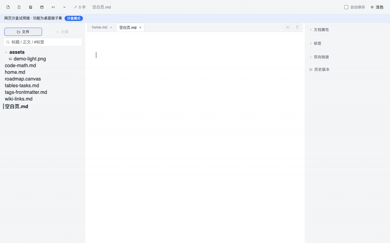<br>[[ 双链]] 输入补全 · Wikilink suggest</td>
    <td align="center">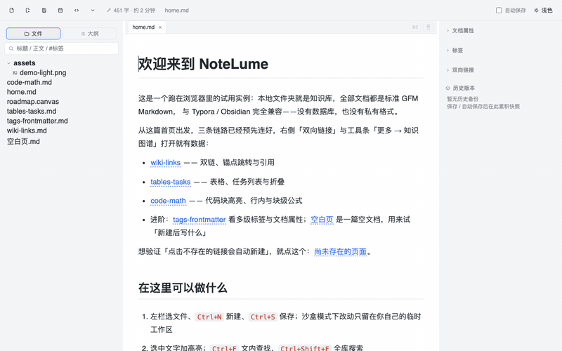<br>单击图表就地出源码 · Edit diagram inline</td>
  </tr>
  <tr>
    <td align="center"><br>表格右键插行插列 · Table editing</td>
    <td align="center">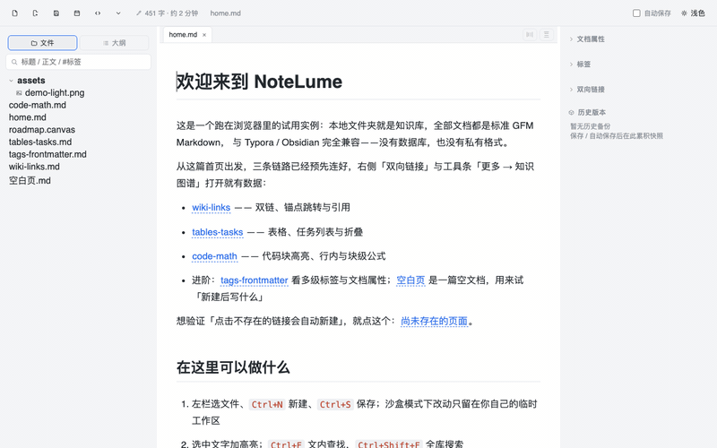<br>正文图片拖拽缩放 · Image resize</td>
  </tr>
  <tr>
    <td align="center">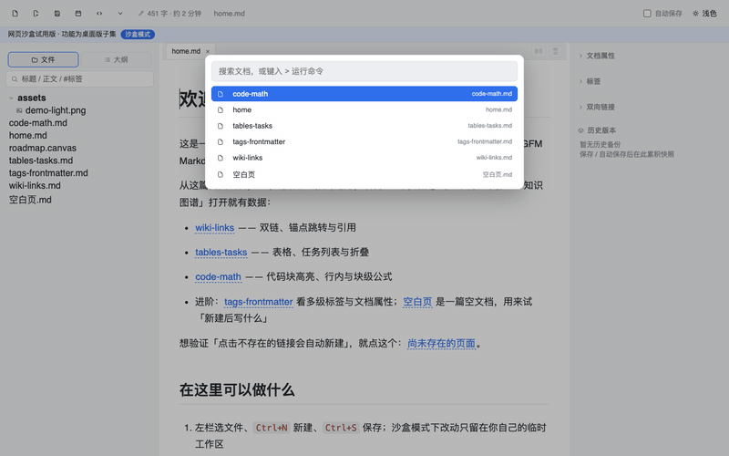<br>命令面板：搜文档、跑命令 · Command palette</td>
    <td align="center">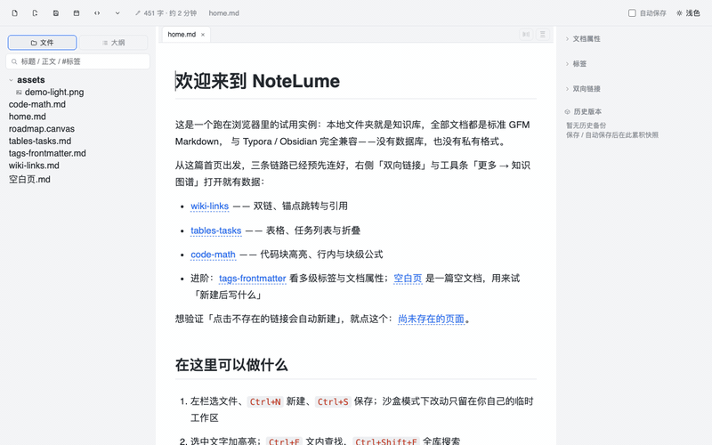<br>大纲按层级折叠 · Outline folding</td>
  </tr>
  <tr>
    <td align="center"><br>双栏对照与多窗格 · Split panes</td>
    <td align="center"><br>专注模式与打字机模式 · Focus &amp; typewriter</td>
  </tr>
  <tr>
    <td align="center"><br>检查器：标签、属性、双向链接、历史 · Inspector</td>
    <td align="center">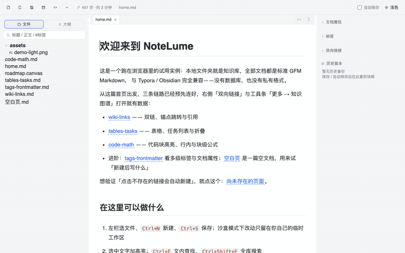<br>今日速记浮层 · Daily capture</td>
  </tr>
  <tr>
    <td align="center"><br>Canvas 便签板拖拽 · Canvas board</td>
    <td align="center">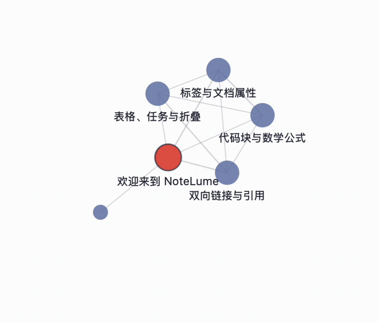<br>知识图谱：拖节点、跳文档 · Knowledge graph</td>
  </tr>
  <tr>
    <td align="center">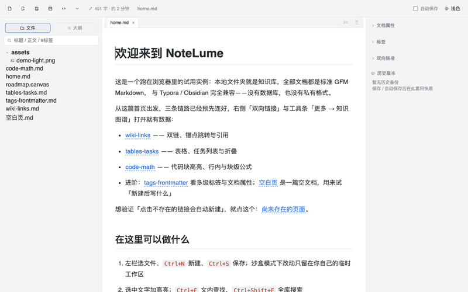<br>Word 导入：左预览右源码，校对后落库 · Word import</td>
    <td align="center">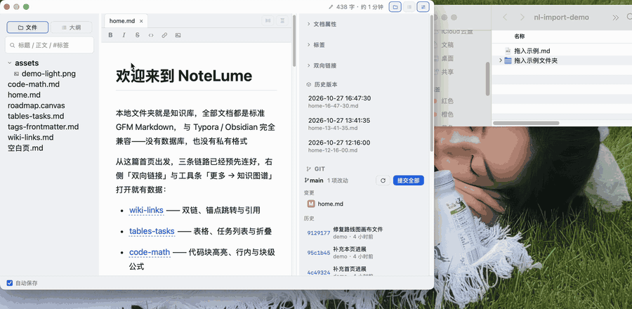<br>拖入文件即打开，拖入文件夹即开库 · Drag &amp; drop</td>
  </tr>
  <tr>
    <td align="center">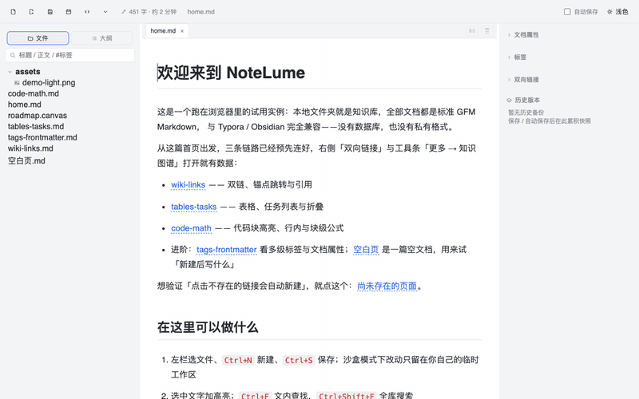<br>四套主题轮换 · Themes</td>
    <td align="center"><br>外观：主题即时切换 · Appearance</td>
  </tr>
  <tr>
    <td align="center">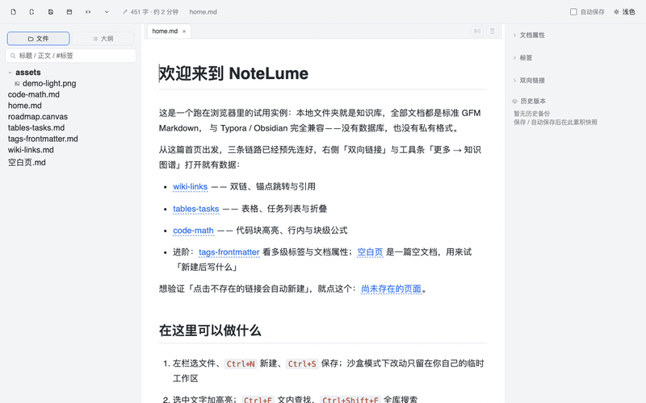<br>快捷键设置：键位一张表 · Shortcuts</td>
    <td align="center"><br>五语言界面即时切换 · Five languages</td>
  </tr>
  <tr>
    <td align="center">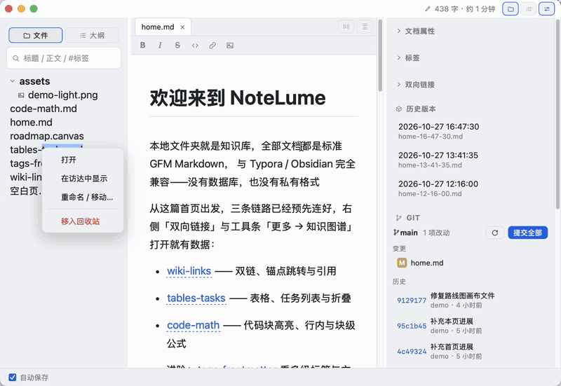<br>文件树与正文右键菜单 · Context menus</td>
    <td align="center">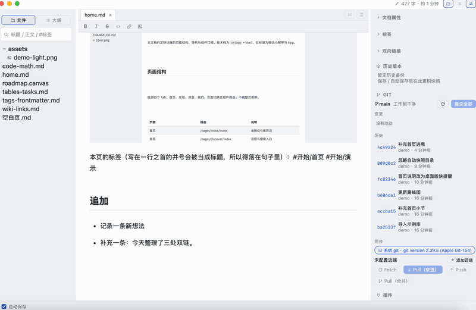<br>Git：暂存、提交、历史 · Git panel</td>
  </tr>
  <tr>
    <td align="center">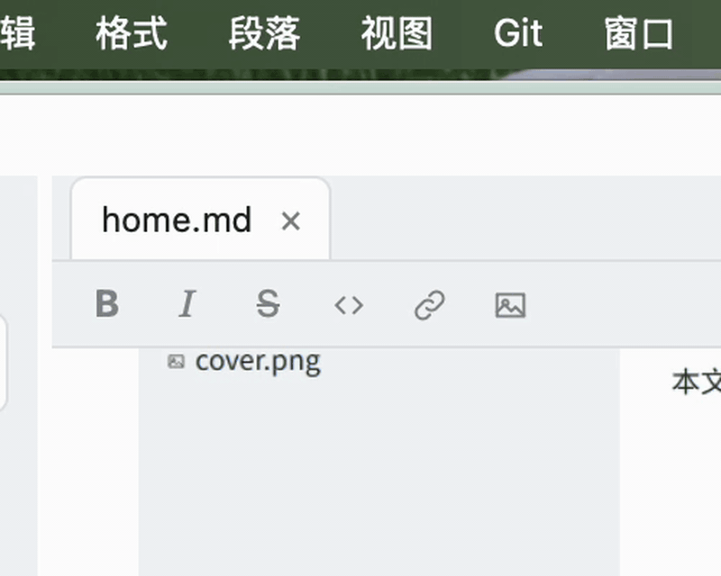<br>系统原生菜单 · Native menus</td>
    <td align="center">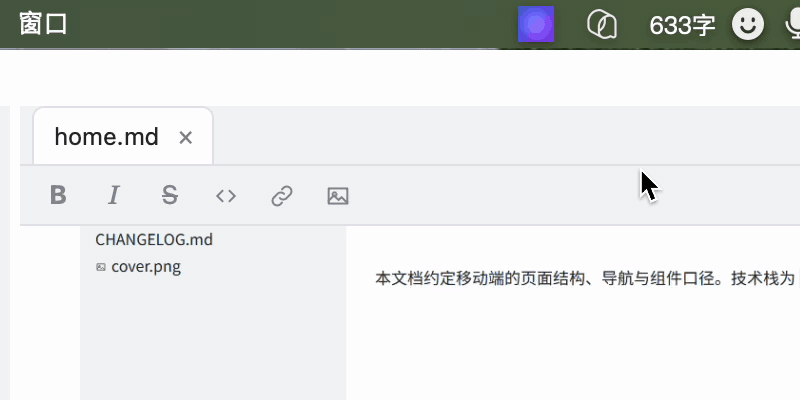<br>菜单栏托盘快捷入口（mac） · Tray menu</td>
  </tr>
</table>

---

## 中文

### 简介

Typora 编辑舒服，但一篇就是一篇，文件多了没组织；Obsidian 有组织，但双栏源码、插件、图谱一层套一层，重。NoteLume（中文名「文溯」）走的是两头都没占的那条路：像 Typora 一样单文档 WYSIWYG 直接写，像 Obsidian 一样把本地文件夹当知识库——\[\[双链\]\]、标签、反链、全文搜索、Git 同步都是内置的，不背插件生态和全量图谱的重量。

**适合谁用**：想要 Typora 的手感、又需要文件一多时找得回来的人。要插件生态、重型图谱、或 Obsidian 默认双栏源码的，请直接用 Obsidian，这里没有。

### 功能亮点

* ✍️ **所写即所得**：Markdown 与富文本双向无损往返；KaTeX 公式、Mermaid 图表、callout 卡片、合并单元格表格、块级裸 HTML、脚注、代码块子语言高亮，全都在渲染态直接编辑
* ✂️ **粘贴自动清理**：从 AI 对话框、飞书、公众号复制的内容直接粘——代码块头部的「复制」按钮、行号装订线、空段落串联在进编辑器前就摘掉，不用粘完再手修第二次
* 🗂 **文件夹即知识库**：`[[wikilink]]` 输入补全与悬浮预览、`#tag` 全局视图、双向链接面板、Canvas 力导向图谱、全库搜索、版本快照一键回滚；文件树右键直接在系统文件管理器里显示
* 🔒 **完全本地、零锁定**：纯 GFM 文件，Typora / Obsidian 可直接打开同一份库；整库可一键导出为标准 Markdown 副本（callout、`![[嵌入]]`、`[[双链]]` 写出时降级），任何编辑器能开；不联网也绝不上传，删除进系统回收站
* 📥 **Word 导入不坏版式**：`.docx` 拖进来，纯 Rust 离线直读 OOXML——标题、列表、超链接、合并单元格表、脚注、图片、公式尽量保真；落库前可视化校对（左预览右源码、降级项列清），图片按内容全库去重，反向还能导出 .docx
* ⚡ **Quarkdown 引擎（对官方 stdlib 差集清零）**：`.var` / `.function` / `.if` / `.foreach` 这套 Turing-complete 语法直接写进 md，快照式预览不碰源文件；约 200 个内置函数——正则替换、表格计算、CSV/JSON 读取、Mermaid 与 xychart 图表、交叉引用与编号系统（`.numbering` 格式串）、BibTeX 参考文献、多语言本地化、emoji 短代码、Bootstrap 图标、`Libraries/` 库目录、atoms 包安装、`.extend` 函数扩展。不用 Quarkdown 语法的文档仍是纯 GFM，Typora / Obsidian 照常打开
* 🎬 **导出一族**：单篇 / 整库幻灯片（自包含 reveal.js HTML，整库按文档分章）、整站静态站、打印排版（Paged.js 预分页：目录页、页码与页眉、H1 分页、封面）、Word .docx、标准 Markdown 副本（Obsidian 私有语法降级）
* 🔄 **Git 内置**：状态 / 历史 / 单文件 diff / 提交 / 推送 / 合并冲突解决全部内建（`git2` 引擎，没装 git 也能 fetch/pull）
* 🌐 **网页剪藏**：浏览器扩展（`extension/`，MV3）把网页正文 POST 给本机服务，Rust 按模板落盘、图片可选本地化进 `assets/`，并自动在文末关联库内相关笔记；只绑 127.0.0.1，只收扩展来源的请求
* 🧩 **功能开关与五语言**：`[[toc]]` 目录块、CSV 表格渲染、emoji 短代码、标题自动编号都是设置里的开关项，全关即标准模式；界面内置简体中文 / 繁體中文 / English / Français / Deutsch
* 📦 **轻**：macOS DMG 约 6 MB；插件系统（`.notelume-plugins/`）内建

### 快速开始

**安装**：到 [Releases](https://github.com/HackerSnail/NoteLume/releases) 下载对应平台的安装包；国内网络改走 [Gitee 发行版](https://gitee.com/hackerSnail/note-lume/releases)（同一批安装包）——

| 平台      | 文件                              | 安装方式            |
| ------- | ------------------------------- | --------------- |
| Windows | `NoteLume_x.y.z_x64-setup.exe`  | 双击安装            |
| macOS   | `NoteLume_x.y.z_aarch64.dmg`    | 拖入 Applications |
| Linux   | `NoteLume_x.y.z_amd64.AppImage` | `chmod +x` 后运行  |

macOS 包只做了 ad-hoc 签名，没走开发者公证。首次打开被系统拦下时，右键应用选「打开」；或先执行 `xattr -dr com.apple.quarantine /Applications/NoteLume.app` 再启动。

**使用**：打开后 `Ctrl+Shift+O` 选一个存着 `.md` 的文件夹作为知识库，开写；只想改单个文件就 `Ctrl+O`。全部键位可在命令面板（`Ctrl+Shift+P`）和快捷键设置里查看、重绑；界面语言在工具条「更多 → 界面语言」切换。

**从源码构建**：需要 Rust 1.80+ 与 Node 18+。

```bash
cd src && npm install && cd ..
npm run dev      # 开发模式（首次约 5–10 分钟编译 Rust 依赖）
npm run build    # 生产打包（产物在 src-tauri/target/release/bundle/）
```

### 进阶：用 Quarkdown 让笔记可编程

这是 NoteLume 区别于 Typora / Obsidian 的一张王牌：md 里可以直接写 `.var` / `.foreach` / `.if` 这类指令，编辑器出求值结果——快照式预览，光标移出指令区即渲染，源文件一个字节不动；导出 HTML / 幻灯片 / 整站 / PDF 时同样展开。

注意：**用了 Quarkdown 指令的文档不再是标准 GFM**——Typora / Obsidian 打开时指令部分显示为普通文本（不含指令的文档不受影响，仍是纯 GFM）。

```markdown
.var {author} {你的名字}
.var {week} {第 42 周}

# 周报 · .week

作者：.author

.foreach {1..3}
    - 条目 .1：一句话说清做了什么
```

编号与交叉引用也能编排：

```markdown
.numbering
    - headings: 1.1
    - figures: (1)

## 背景 {#intro}

见 .ref {intro}。
```

约 200 个内置函数：正则替换、CSV / JSON 读取、表格计算、BibTeX 参考文献、多语言本地化、emoji 短代码、`.extend` 自定义扩展。**不用学语法也能上手**：斜杠菜单（`/`）里搜 Quarkdown 有即插即出的片段；工具条「模板」菜单带三个开箱即跑的内置模板（周报、变量化文档头、编号与交叉引用）。完整函数清单见 [`docs/FEATURES.md`](docs/FEATURES.md)。

### 网页剪藏

把浏览器里的网页正文存进知识库：按模板落盘成标准 md，图片进 `assets/`，文末自动关联库内相关笔记。

1. **装扩展**：Edge 地址栏输 `edge://extensions`，打开左下角「开发人员模式」，点「加载已解压缩的扩展」选仓库里的 `extension/` 目录（Chrome 是 `chrome://extensions` → 右上角「开发者模式」→「加载已解压的扩展程序」）。加载后建议在工具栏拼图菜单里把「NoteLume 剪藏」固定出来。
2. **NoteLume 里开服务**：mac 从菜单栏「NoteLume → 网页剪藏设置」进入，Windows / Linux 走工具条「更多 → 网页剪藏设置」；勾选「启用剪藏服务」后保存，状态栏显示「剪藏服务已启动：127.0.0.1:<端口>」。同一个设置里还能选模板（库内 `Templates/` 下的 md）、目标目录（默认 `Clippings/`）、文件名模式（默认 `{{date}}-{{title}}`）、自动关联的篇数，以及图片本地化与整页兜底两个开关。
3. **扩展里填地址**：右键扩展图标 →「选项」，服务器地址填设置里显示的地址（默认 `http://127.0.0.1:3210`），「测试连接」应回「连接正常 · 已打开知识库」。填这一项就够了。
4. **剪**：点固定出来的扩展图标剪整页；或先在页面上选中文字，右键「剪藏选中内容到 NoteLume」只剪片段（用内置 highlight 模板落盘，来源行进引用块）。

正文提取按优先级降级：Defuddle → Readability + Turndown →（设置里打开「整页兜底」才有）整页 HTML。剪藏落在 `Clippings/<日期>-<标题>.md`，frontmatter 记 `title / source / author / published_at / clipped_at / tags / template`，文末「\#\# 相关笔记」列出打分最高的相关文档，点开即跳；被关联文档的反链面板里也能看到这篇剪藏。

图片本地化默认关：正文保留网页原链接，剪藏快，但外链图在离线 / 防盗链场景会裂图。在剪藏设置里勾选「图片本地化」后，扩展才把图取成 data URI 落 `Clippings/assets/`（按内容去重，md 里是 `./assets/` 相对链接）。

服务只绑 `127.0.0.1`，且只收扩展来源的请求（网页的 fetch 到不了）。NoteLume 没开、没开知识库、内容超过 8MB 时，扩展会弹对应的失败通知。详细错误对照见 `extension/README.md`。

### 快捷键

mac 上 `Ctrl` 即 `⌘`。以下键位按 Typora / Obsidian 主流习惯预置，全部可在「快捷键设置…」里重绑（mac 在菜单栏 NoteLume 下，Windows / Linux 在工具条「更多」里；冲突会硬阻止保存）。

**文件与导航**

| 键位                            | 作用                     |
| ----------------------------- | ---------------------- |
| `Ctrl+N`                      | 新建文件（先落系统临时目录，不要求开库）   |
| `Ctrl+O`                      | 打开单个 Markdown 文件       |
| `Ctrl+Shift+O`                | 打开文件夹作为知识库             |
| `Ctrl+Tab` / `Ctrl+Shift+Tab` | 切换下一个 / 上一个标签页         |
| `Ctrl+W`                      | 关闭当前标签页                |
| `F2`                          | 重命名当前文件（可顺带移动）         |
| `Ctrl+S`                      | 保存（临时文件 = 另存为，选正式位置）   |
| `Ctrl+P`                      | 打印 / 另存 PDF            |
| `Ctrl+Shift+P`                | 命令面板（模糊搜命令 / 文档）       |
| `Ctrl+E`                      | 正文与 Markdown 源码整篇互切    |
| `Ctrl+F`                      | 本篇文档内查找                |
| `Ctrl+H`                      | 本篇文档内查找替换              |
| `Ctrl+Shift+F`                | 聚焦侧栏全局搜索               |
| `Ctrl+Shift+V`                | 粘贴为纯文本                 |
| `Ctrl+Shift+I`                | 插入图片（自动入库 `assets/`）   |
| `Ctrl+K`                      | 插入 / 编辑链接（地址留空 = 解除链接） |

**格式与段落**

| 键位                              | 作用               |
| ------------------------------- | ---------------- |
| `Ctrl+B` / `Ctrl+I`             | 粗体 / 斜体          |
| `` Ctrl+` ``                    | 行内代码             |
| `Ctrl+Shift+K`                  | 代码块              |
| `Ctrl+Shift+X`                  | 删除线              |
| `Ctrl+1` \~ `Ctrl+6`            | 设为一级 \~ 六级标题     |
| `Ctrl+]` / `Ctrl+[`             | 提升 / 降低标题级别      |
| `Ctrl+Shift+Q`                  | 引用块              |
| `Ctrl+Shift+L`                  | 任务列表             |
| `Ctrl+Shift+[` / `Ctrl+Shift+]` | 无序 / 有序列表        |
| `Ctrl+T`                        | 插入表格             |
| `Ctrl+D`                        | 删除当前行 / 段落       |
| `Ctrl+M`                        | 插入行内公式（有选区则包裹）   |
| `Ctrl+Shift+M`                  | 插入块级公式           |
| `Ctrl+Z` / `Ctrl+Y`             | 撤销 / 重做          |
| `Shift+Enter`                   | 硬换行              |
| `Tab` / `Shift+Tab`             | 表格单元格间跳转（末行自动补行） |

**视图**

| 键位                 | 作用                |
| ------------------ | ----------------- |
| `Ctrl+G`           | 打开 / 关闭知识图谱       |
| `Ctrl+Shift+D`     | 今日速记（全局浮层，独立于知识库） |
| `` Ctrl+Shift+` `` | 专注模式（当前块高亮）       |
| `Ctrl+Shift+T`     | 打字机模式（当前块居中）      |
| `Ctrl+Shift+S`     | 隐藏 / 显示侧栏         |
| `Ctrl+Shift+B`     | 隐藏 / 显示右侧检查器栏     |
| `Ctrl+Shift+H`     | 折叠 / 展开当前节        |

### 技术栈

| 层    | 选型                                                           |
| ---- | ------------------------------------------------------------ |
| 桌面外壳 | Tauri v2 + Rust（文件 I/O、索引、docx 解析、Git、Quarkdown 引擎全在 Rust 侧） |
| 编辑器  | ProseMirror（WYSIWYG）+ CodeMirror 6（源码模式），无 Vue/React 框架      |
| 前端构建 | Vite                                                         |
| 存储   | 本地文件夹 + 标准 GFM `.md`，无数据库、无私有格式                              |

### 贡献指南

1. Fork 仓库，基于 `master` 切出自己的分支（网页版开发隔离在 `web` 分支，请勿向上合并）
2. 改动后跑离线回归：`npm run test:roundtrip`，或逐个执行 `src/tests/*.test.mjs`
3. 提交 PR，CI（GitHub Actions）会自动跑前端测试、Rust check/test 与三平台构建
4. 设计文档与迭代规划见 [`docs/CLAUDE.MD`](docs/CLAUDE.MD)、[`docs/ROADMAP.md`](docs/ROADMAP.md)；逐项功能细节与已知边界见 [`docs/FEATURES.md`](docs/FEATURES.md)

Issue 和 PR 都欢迎，也欢迎任何形式的功能建议。

### 致谢

* [Quarkdown](https://github.com/iamgio/quarkdown) by iamgio —— NoteLume 并未引入、修改或移植 Quarkdown 的任何源代码。全部内部抽象语法树、数据结构、解析处理流水线均使用 Rust 独立实现，NoteLume 与 Quarkdown 不存在衍生作品关系，NoteLume 主体代码遵循 Apache-2.0 许可证。

### 许可证

[Apache License 2.0](LICENSE) · Copyright 2026 hackerSnail

---

## English

### Overview

Typora edits beautifully, but one file is one file — past a handful of notes there is no organization. Obsidian organizes, but split panes, source mode, plugins and the graph stack up into something heavy. NoteLume (Chinese name: 文溯, *Wènsù*) takes the road neither occupies: single-document WYSIWYG like Typora, a local folder as a vault like Obsidian — `[[wikilinks]]`, tags, backlinks, full-text search and Git sync are built in, without the weight of a plugin ecosystem or a full-scale graph.

**Who it's for**: people who want Typora's feel and still need to find things when the file count grows. If you want a plugin ecosystem, a heavyweight graph, or Obsidian's default split-pane source mode, use Obsidian — you won't find those here.

### Highlights

* ✍️ **True WYSIWYG**: lossless Markdown round-trip; edit KaTeX math, Mermaid diagrams, callouts, merged-cell tables, literal HTML blocks, footnotes, and syntax-highlighted code blocks right in the rendered view
* ✂️ **Paste auto-clean**: content copied from AI chat apps, Feishu, or WeChat pastes clean — copy buttons, line-number gutters, and chains of empty paragraphs are stripped before the editor sees them, no second-pass fixing
* 🗂 **A folder is a vault**: `[[wikilink]]` autocomplete with hover preview, global tag view, backlinks panel, Canvas-based knowledge graph, vault-wide search, snapshot history with one-click rollback; right-click any tree entry to reveal it in your system file manager
* 🔒 **Local-first, no lock-in**: pure GFM — Typora and Obsidian can open the same vault; export the whole vault as a plain-Markdown copy with Obsidian-specific syntax (callouts, `![[embeds]]`, `[[wikilinks]]`) downgraded on the way out, readable in any editor; nothing ever leaves your machine; deletions go to the system trash
* 📥 **Word imports intact**: drop in a `.docx` and a pure-Rust OOXML reader maps it to Markdown offline — headings, lists, hyperlinks, merged-cell tables, footnotes, images, even math survive; proofread in a side-by-side review modal before it lands in your vault, with images deduplicated by content hash; export back to .docx works too
* ⚡ **Quarkdown engine (feature-complete against the official stdlib)**: Turing-complete `.var` / `.function` / `.if` / `.foreach` macros live right in your Markdown, snapshot-previewed without touching the source; about 200 builtins — regex replace, table computation, CSV/JSON readers, Mermaid & xychart diagrams, cross-references and numbering (`.numbering` formats), BibTeX bibliographies, localization tables, emoji shortcodes, Bootstrap icons, a `Libraries/` folder, atoms package installs, and `.extend` function wrapping. Documents without Quarkdown syntax stay pure GFM that Typora and Obsidian open as-is
* 🎬 **Export family**: single-document and whole-vault slide decks (self-contained reveal.js HTML, one chapter per document), static-site export, paged print & PDF (Paged.js: TOC page, page numbers & running heads, H1 page breaks, cover page), Word .docx, and a plain-Markdown vault copy with Obsidian-specific syntax downgraded
* 🔄 **Git built in**: status / history / per-file diff / commit / push / merge-conflict resolution, powered by embedded `git2` — works even without a system Git installed
* 🌐 **Web clipping**: a browser extension (`extension/`, MV3) POSTs page content to a local server; Rust writes it per template into your vault, can localize images under `assets/` (off by default), and appends links to related notes — loopback-only, extension-origin gated
* 🧩 **Feature flags & five languages**: `[[toc]]` blocks, CSV table rendering, emoji shortcodes, and heading numbering are all toggles — everything off means standard mode; the UI ships in 简体中文 / 繁體中文 / English / Français / Deutsch
* 📦 **Featherweight**: the macOS DMG is about 6 MB; a plugin system (`.notelume-plugins/`) comes standard

### Quick Start

**Install**: grab the package for your platform from [Releases](https://github.com/HackerSnail/NoteLume/releases) —

| Platform | File                            | How                  |
| -------- | ------------------------------- | -------------------- |
| Windows  | `NoteLume_x.y.z_x64-setup.exe`  | Run the installer    |
| macOS    | `NoteLume_x.y.z_aarch64.dmg`    | Drag to Applications |
| Linux    | `NoteLume_x.y.z_amd64.AppImage` | `chmod +x`, then run |

The macOS build carries an ad-hoc signature only (no developer notarization). If Gatekeeper blocks the first launch, right-click the app and choose Open, or run `xattr -dr com.apple.quarantine /Applications/NoteLume.app` first.

**Use**: press `Ctrl+Shift+O` and point NoteLume at a folder of `.md` files to open it as a vault, or `Ctrl+O` for a single file. Every shortcut is discoverable in the command palette (`Ctrl+Shift+P`) and fully remappable; the UI language switches under More → Interface language.

**Build from source**: requires Rust 1.80+ and Node 18+.

```bash
cd src && npm install && cd ..
npm run dev      # dev mode (first Rust build takes ~5–10 min)
npm run build    # release bundles, output under src-tauri/target/release/bundle/
```

### Advanced: Programmable Notes with Quarkdown

This is NoteLume's ace against Typora and Obsidian: Markdown documents can carry `.var` / `.foreach` / `.if` directives, and the editor shows the evaluated result — snapshot-style preview, rendered as soon as the cursor leaves the directive, without touching the source file. HTML / slides / site / PDF exports expand it too.

Note: **documents carrying Quarkdown directives are no longer standard GFM** — Typora / Obsidian render the directives as plain text (documents without directives are unaffected).

```markdown
.var {author} {Your name}
.var {week} {Week 42}

# Weekly · .week

Author: .author

.foreach {1..3}
    - Item .1: one line on what was done
```

Numbering and cross-references compose as well:

```markdown
.numbering
    - headings: 1.1
    - figures: (1)

## Background {#intro}

See .ref {intro}.
```

About 200 builtins: regex replace, CSV / JSON readers, table computation, BibTeX, localization, emoji shortcodes, `.extend` wrapping. **No syntax learning required to start**: the slash menu (`/`) has ready-to-insert snippets (search Quarkdown), and the toolbar Templates menu ships three runnable built-in templates (weekly report, variable document header, numbering & cross-references). The full function list is in [`docs/FEATURES.md`](docs/FEATURES.md).

### Web Clipping

Save web pages into your vault: content lands as standard Markdown per your template, images go to `assets/`, and related notes are linked at the end of the clip.

1. **Install the extension**: open `edge://extensions` (Chrome: `chrome://extensions`), turn on developer mode, click "Load unpacked" and pick the `extension/` folder in this repo. Pin "NoteLume 剪藏" to the toolbar from the puzzle menu.
2. **Start the server in NoteLume**: on macOS use the menu bar → NoteLume → Web clipping settings; on Windows / Linux use toolbar → More → Web clipping settings. Check "Enable clipping server" and save. The status bar shows the actual address (default `http://127.0.0.1:3210`) — the port may shift if 3210 is taken. The same panel picks the template (a Markdown file under `Templates/`), the target folder (default `Clippings/`), the filename pattern (default `{{date}}-{{title}}`), how many related notes to link, and the two switches for image localization and whole-page fallback.
3. **Point the extension at it**: right-click the extension icon → Options, fill in the address shown in NoteLume (default `http://127.0.0.1:3210`), then "Test connection" should report OK with an open vault. That's the only field you need — no token.
4. **Clip**: click the pinned icon for the whole page, or select text first and right-click → "剪藏选中内容到 NoteLume" for just the selection (which lands through the built-in highlight template, with the source as a block quote).

Content extraction falls back in order: Defuddle → Readability + Turndown → whole-page HTML (only if "Fall back to the whole page" is enabled). Clips land at `Clippings/<date>-<title>.md` with a `title / source / author / published_at / clipped_at / tags / template` frontmatter, and a "\#\# 相关笔记" section at the end listing the highest-scoring related documents — clickable both ways, since the linked documents also see the clip in their backlinks panel.

Image localization is off by default: markdown keeps the original remote links, which is fast but breaks offline or behind hotlink protection. Enable "Localize images" in the clipping settings and the extension fetches images as data URIs into `Clippings/assets/` (content-deduplicated, referenced as `./assets/` relative links).

The server listens on `127.0.0.1` only and accepts extension-origin requests only (web pages can't reach it). The extension notifies you when NoteLume isn't running, no vault is open, or the payload exceeds 8 MB. See `extension/README.md` for the full error table.

### Keyboard Shortcuts

On macOS, `Ctrl` means `⌘`. Everything below follows Typora / Obsidian conventions and is fully remappable in Settings → Shortcuts (conflicts are hard-blocked).

**Files & navigation**

| Keys                          | Action                                                    |
| ----------------------------- | --------------------------------------------------------- |
| `Ctrl+N`                      | New file (lands in a temp scratch dir; no vault required) |
| `Ctrl+O`                      | Open a single Markdown file                               |
| `Ctrl+Shift+O`                | Open a folder as a vault                                  |
| `Ctrl+Tab` / `Ctrl+Shift+Tab` | Next / previous tab                                       |
| `Ctrl+W`                      | Close current tab                                         |
| `F2`                          | Rename current file (doubles as move)                     |
| `Ctrl+S`                      | Save (a scratch file becomes Save As)                     |
| `Ctrl+P`                      | Print / export PDF                                        |
| `Ctrl+Shift+P`                | Command palette (fuzzy-search commands & docs)            |
| `Ctrl+E`                      | Toggle between WYSIWYG and Markdown source                |
| `Ctrl+F`                      | Find in document                                          |
| `Ctrl+H`                      | Find & replace in document                                |
| `Ctrl+Shift+F`                | Focus vault-wide search                                   |
| `Ctrl+Shift+V`                | Paste as plain text                                       |
| `Ctrl+Shift+I`                | Insert image (auto-saved to `assets/`)                    |
| `Ctrl+K`                      | Insert / edit link (empty URL removes it)                 |

**Format & blocks**

| Keys                            | Action                                              |
| ------------------------------- | --------------------------------------------------- |
| `Ctrl+B` / `Ctrl+I`             | Bold / italic                                       |
| `` Ctrl+` ``                    | Inline code                                         |
| `Ctrl+Shift+K`                  | Code block                                          |
| `Ctrl+Shift+X`                  | Strikethrough                                       |
| `Ctrl+1` \~ `Ctrl+6`            | Heading level 1–6                                   |
| `Ctrl+]` / `Ctrl+[`             | Promote / demote heading                            |
| `Ctrl+Shift+Q`                  | Blockquote                                          |
| `Ctrl+Shift+L`                  | Task list                                           |
| `Ctrl+Shift+[` / `Ctrl+Shift+]` | Bullet / numbered list                              |
| `Ctrl+T`                        | Insert table                                        |
| `Ctrl+D`                        | Delete current line / block                         |
| `Ctrl+M`                        | Inline math (wraps selection if any)                |
| `Ctrl+Shift+M`                  | Block math                                          |
| `Ctrl+Z` / `Ctrl+Y`             | Undo / redo                                         |
| `Shift+Enter`                   | Hard line break                                     |
| `Tab` / `Shift+Tab`             | Jump between table cells (appends a row at the end) |

**View**

| Keys               | Action                                                   |
| ------------------ | -------------------------------------------------------- |
| `Ctrl+G`           | Toggle knowledge graph                                   |
| `Ctrl+Shift+D`     | Daily capture (global overlay, independent of the vault) |
| `` Ctrl+Shift+` `` | Focus mode (highlight current block)                     |
| `Ctrl+Shift+T`     | Typewriter mode (center current block)                   |
| `Ctrl+Shift+S`     | Toggle sidebar                                           |
| `Ctrl+Shift+B`     | Toggle right inspector                                   |
| `Ctrl+Shift+H`     | Fold / unfold current section                            |

### Tech Stack

| Layer   | Choice                                                                                                      |
| ------- | ----------------------------------------------------------------------------------------------------------- |
| Shell   | Tauri v2 + Rust (file I/O, indexing, docx parsing, Git, and the Quarkdown engine all live on the Rust side) |
| Editor  | ProseMirror (WYSIWYG) + CodeMirror 6 (source mode), no UI framework                                         |
| Bundler | Vite                                                                                                        |
| Storage | Plain folders of GFM `.md` — no database, no proprietary format                                             |

### Contributing

1. Fork the repo and branch off `master` (the web edition is isolated on the `web` branch — never merge it upstream)
2. Run the offline regression suite: `npm run test:roundtrip`, or execute `src/tests/*.test.mjs` individually
3. Open a PR — CI (GitHub Actions) runs frontend tests, Rust check/test, and three-platform builds
4. Design docs live in [`docs/CLAUDE.MD`](docs/CLAUDE.MD) and [`docs/ROADMAP.md`](docs/ROADMAP.md); the exhaustive feature list and known limits are in [`docs/FEATURES.md`](docs/FEATURES.md)

Issues and PRs of every kind are welcome.

### Acknowledgements

* [Quarkdown](https://github.com/iamgio/quarkdown) by iamgio —— NoteLume does not import, modify, or port any Quarkdown source code. All internal abstract syntax trees, data structures, and parsing pipelines are implemented independently in Rust; NoteLume is not a derivative work of Quarkdown, and NoteLume's main codebase is licensed under Apache-2.0.

### License

[Apache License 2.0](LICENSE) · Copyright 2026 hackerSnail

<!-- links -->