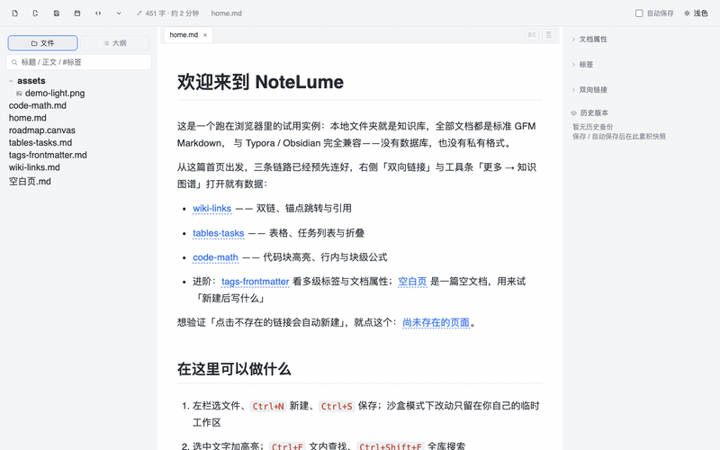
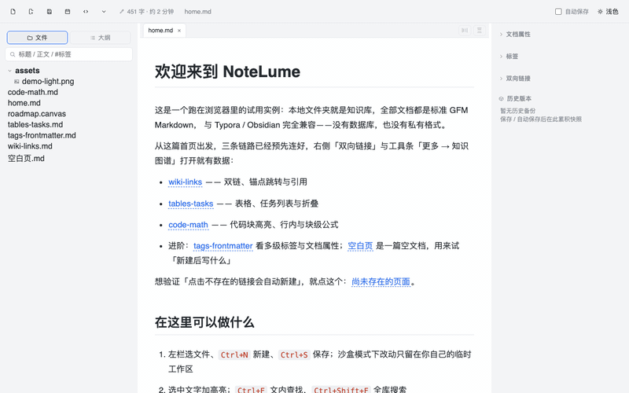
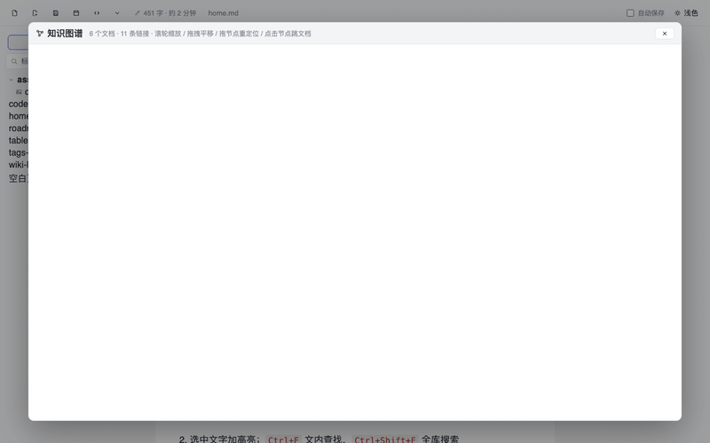
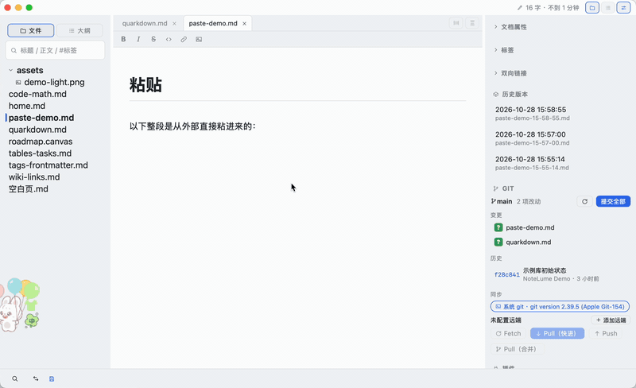
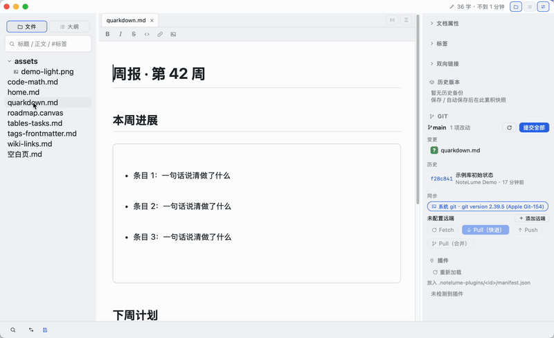

# 界面演示动图

仓库里的功能演示动图分两条录制路线：

| 路线 | 覆盖界面 | 录制方式 |
| --- | --- | --- |
| 网页版 | 编辑器与行内渲染、斜杠菜单、表格、图片缩放、大纲、分栏、专注 / 打字机、速记、检查器、全库搜索、全局标签、双向链接、知识图谱、外观 / 快捷键 / 语言设置、Canvas、Word 导入 | 脚本驱动 headless Chrome 逐帧抓取 |
| 桌面版 | 托盘、原生菜单、Git、知识图谱、右键菜单、拖入打开 | 脚本合成鼠标键盘操作，系统录屏后裁切转 GIF |

网页版的画面来自 `web` 分支的网页沙盒，抓帧脚本放在主干 `examples/gif-demo/`。脚本只是录制工具，不参与任何构建，也不把网页版产物带进主干。

## 一、网页版：脚本抓帧

### 1. 准备前后端

```bash
git fetch origin web
git worktree add .others/web-gif origin/web
cd .others/web-gif
```

前端依赖与主工作区共用同一份 `src/package.json`，把已安装的目录直接链过来即可（主工作区没装过依赖的话，先在仓库根执行 `npm --prefix src ci`）：

```bash
cp -al ../../src/node_modules src/node_modules
npm --prefix server install
npm i --no-save puppeteer-core
```

`--no-save` 只把抓帧用的 `puppeteer-core` 装进 `node_modules`，不改 `package.json`。抓帧还需要本机 Chrome 与 ffmpeg（`brew install ffmpeg`）。

### 2. 构建并起服务

```bash
npm run web:build
node server/serve.mjs --sandbox --port 1477 --host 127.0.0.1
```

`--sandbox` 让每个浏览器会话拿到一份独立工作区：演示库从 `server/default-vault` 现灌一份，页面关掉约三分钟后整份回收。重复录制之间不互相污染，帧里也不会残留上一场的输入。

### 3. 抓一个场景

从仓库根把脚本拷进工作树，再按场景名运行：

```bash
mkdir -p .others/web-gif/capture
cp examples/gif-demo/*.mjs .others/web-gif/capture/
cd .others/web-gif
node capture/shoot.mjs theme-switch
```

产物在 `/tmp/nl-gif/<场景名>/`：`frames/*.png` 是原始帧，`<场景名>.gif` 是编码结果，默认 800 宽；第二个参数可以改宽度。

### 4. 现有场景

#### 输入即渲染 `wysiwyg-typing`


标题走快捷键，正文里的 `**重点**`、`*强调*`、`#project`、`$E=mc^2$`、`[[wiki-links]]` 在语法落定时直接换成富文本，不用切预览。

#### 双链补全 `wikilink-suggest`


敲 `[[` 弹出候选，继续打字按名称过滤，回车插入链接节点。

#### 命令面板 `command-palette`


裸词搜文档；前缀 `>` 切成命令模式，选中「Markdown 源码模式」后整篇切到源码态。

#### 正文与源码互切 `source-toggle`


源码态里补一段 Markdown，切回正文时按规则渲染成标题与列表。

#### 主题轮换 `theme-switch`


浅色、暗黑、Dracula、跟随系统四态，按顺序循环。

#### 富文本渲染 `rich-render`


代码高亮、块级公式、Mermaid 流程图、表格逐段滚过。

#### 分栏 `split-panes`


把一个窗格拆成两个，左右各自开文档、各自滚动。

#### 大纲层级折叠 `outline-fold`


侧栏切到「大纲」，逐节收起小标题，再按档位条的 H1 一键收到只剩大标题，最后一点回到全展开。

#### 专注与打字机 `view-modes`


`Ctrl+Shift+`` 隐去无关内容只留当前段，`Ctrl+Shift+T` 让光标行始终停在版面中部。

#### 今日速记 `daily-capture`


独立于当前知识库的浮层，按日期落到速记目录。

#### 斜杠菜单 `slash-menu`


敲 `/` 搜块类型，回车插入；表格、代码、公式、Quarkdown 片段都从这里出。

#### 界面语言 `language-switch`


「更多 → 界面语言」切到 English，整站文案当场换掉。

#### 正文图片缩放 `image-resize`


按住图片右下角把手拖动，宽度按比例写回 md 的图片后缀，原图不动。

#### 表格就地编辑 `table-edit`


Tab 逐格跳转；单元格右键出菜单（插行、插列、删除、四向对齐、表头切换、合并拆分），镜头点其中「下方插入行」与「右侧插入列」两项。

#### Mermaid 就地改码 `mermaid-edit`


单击渲染出来的图表，光标直接落进上方代码块，改完移开即重渲染。

#### Canvas 便签板 `canvas-board`


打开 `.canvas`，按住便签拖动，连线跟着走。

#### 右侧检查器 `inspector-panel`


标签、文档属性（frontmatter）、双向链接、历史版本收在一栏里。

#### 外观设置 `appearance-settings`


外观面板里连点三套主题，正文与代码配色当场跟着换。

#### 快捷键设置 `shortcuts-settings`


全部键位列成一张可滚动的表；重绑走同一面板，撞键当场拦下、不会静默丢掉（镜头只滚列表，未演示重绑）。

#### Word 导入校对 `docx-import`


「更多 → 导入 Word」选库内 `.docx` → 左预览右源码的校对窗（降级项列在窗顶）→ 接受才落库并自动打开。

#### 全库搜索 `vault-search`



侧栏搜索框输入即查，卡片按命中来源带「标题」「标签」角标，点一张直接打开那篇。

#### 全局标签 `global-tags`



检查器「标签」面板列出全库标签与计数，点一个标签就地展开含该标签的文档，再点文档跳过去。

#### 双向链接 `backlinks`


打开 `wiki-links.md`，检查器「双向链接」给出「引用本文档」与「本文档引用」两列，点一行跳到那篇引用者。

#### 知识图谱铺盘 `knowledge-graph`



`⌘G` 就地铺开全库节点，力导预热几帧后自己散开；拖一个节点看回弹，原位再点一下关窗并跳到那篇文档。桌面版另有一段带窗口边框的近景（`desktop-graph`）。

### 5. 加新场景

场景写在 `scenarios.mjs`，`shoot.mjs` 提供操作原语：`type`、`press`、`click`、`clickText`、`clickPoint`、`clickMatch`、`rightClick`、`drag`、`move`、`scroll`、`wait`、`js`。约定只有一条：画面必须由真实输入事件产生，不直接改 DOM、不调应用内部函数。

几条实测下来容易踩的：

- 空格与换行必须走真实按键。`keyboard.type` 对它们的实现会退化成 `Input.insertText`，挂在 `handleTextInput` 上的行内规则收不到，画面里只剩字面量。
- 快捷键写 `Meta+…`。headless Chrome 在 macOS 上把 `Mod` 解析成 Meta；这个版本的 puppeteer 不认 `Meta+1` 这种连写，`press` 里已拆成按下修饰键、敲主键、松开。
- 边打边变的只有行内规则：`#tag`（标签字符限 ASCII）、`$公式$`、`[[双链]]`、`**粗**` 一类强调。行首没有 `# `、`- ` 这样的标题与列表规则，标题要用快捷键或斜杠菜单。
- 打开文档、切换主题之后留 600 到 900 毫秒再抓，否则拿到的是过渡中的一帧。
- screencast 只在画面变化时推帧。脚本按每帧的 screencast 时间戳写一份 concat 清单交给 ffmpeg，静止停留才不会被压成闪帧。
- 网页沙盒没有插件目录，开库时后端会回一条 desktop-only 拒绝，提示条会糊在画面底部；顶部还有一条「网页沙盒试用版 · 功能为桌面版子集」横幅。这两样都属于运行环境而不是功能，脚本在抓帧前用一行 CSS 藏掉 `#nl-web-toasts` 与 `#nl-web-banner`，其余界面元素不动。
- 搜索、全局标签、反链、图谱这几项都吃 `state.indexReady`，而它要求后端 `get_index_status` 回的库根与前端 `state.vaultRoot` 归一后相等。macOS 的 `os.tmpdir()` 落在 `/var` → `/private/var` 这条链接之下，沙盒早先只有一侧做了 realpath：前端拿 `/var/…`、索引回填 `/private/var/…`，`normVaultPath` 又只归一大小写与尾斜杠、不解链接，于是 `indexReady` 恒假，这几块面板全空。现在 `server/src/paths.mjs` 的 `jailRoot` 统一 `fs.realpathSync` 后再往外发，`server/tests/sandbox.test.mjs` 有断言钉住两侧一致。
- 搜索框里的上一条查询要清干净再打下一条：`⌘A` 会被应用级快捷键抢走，`Escape` 只在焦点还留在输入框时才清（点过命中卡片后焦点已经跑到正文）。脚本里用输入框自己的 `select()` 选中整串，随后真实按键直接替换。
- 标签查询不带 `#`。索引存的是去掉井号的标签名，搜索按子串匹配（桌面版 Rust 同一行为），`#能力/表格` 只会得到「无匹配」。
- 图谱节点坐标只在 canvas 内部，外面读不到。定位靠真实悬停：命中时 `graph-view.js` 把 cursor 改成 `pointer`，脚本从画布中心一圈圈探出去；拖拽松手处就是那个节点，原位再点一下（位移 <3px 按点击算）即关窗跳文档。
- 大纲 tab 在文档没有标题时会被 `syncOutlineTab` 藏掉，切过去也留不住。要先打完标题再点 tab；取不到可见的 `.outline-toolbar button` 就是这个原因。
- 要真实 ⌘V 的功能（粘贴自动清理）在 headless 里出不来画面：合成按键走 `Input.dispatchKeyEvent`，不经过 Chrome 的菜单 / 加速器通道，按下去正文纹丝不动。页面里 `navigator.clipboard.write` 写 `text/html` 是通的（`clipboard-write` 对 127.0.0.1 直接 granted），但 `clipboard-read` 是 prompt，且 ProseMirror 只听 `paste` 事件——这条路留给桌面版镜头。
- 网页工作树落后主干时，主干新加的功能不会出现在画面里。录制新一轮之前先把主干合进 `web`（方向允许，见 `docs/SERVER.MD`），重新 `npm run web:build`。

## 二、桌面版：脚本驱动 + 系统录屏

桌面版没有网页版那套沙盒和 CDP。画面来自系统录屏，操作由脚本合成真实的鼠标键盘事件完成，镜头每次重跑都走同一条时间轴。

### 0. 先确认屏幕录制权限

系统设置 → 隐私与安全性 → 屏幕录制，给发起录制的应用（终端或 Qoder）打开开关，按提示重启该应用。

没这个授权时，`screencapture` 全屏只拿到壁纸和左侧菜单，`-l <窗口ID>` 直接报 `could not create image from window`，`-v` 录像报 `capture error`。这不是窗口在别的桌面空间，授权之后同样区域就能录到。

Computer Use 的截图策略是 AX_ONLY，`getAppState` 只回一张空白占位图，所以 CU 适合读控件树、点按钮，像素仍要靠系统录屏。

### 1. 准备演示库

另开一份示例库副本，在里面 `git init`，提交身份设成中性名字，录制过程产生的提交与编辑都落在这份副本里。不要用日常使用的库：托盘「打开最近」列的是本机真实笔记名，这些标题会原样出现在画面里。快照目录也在副本里，随手 `gitignore` 掉，免得「变更」面板被自动备份刷满。

录制前用 AX 把窗口挪到固定原点。桌面上如果有常驻浮层，裁切窗口时会带进来。

### 2. 驱动界面

两条通道配合使用：

- AX 按名字找控件、读数、`AXPress`。网页视图里的工具栏按钮、检查器、输入框都能读到。
- CGEvent 合成鼠标点击、拖拽、滚轮和键盘。悬停、快捷键这类操作 AX 给不了，只能合成。

菜单栏是例外：原生菜单项的坐标读出来是负值，改成截图量菜单栏条目的横坐标，再按固定偏移点下去。

坐标不能缓存。保存一次快照之后，检查器里的历史列表会变长，下面所有按钮整体下移；每次点击前现量一遍再点。

合成快捷键时要把修饰键的 `flagsChanged` 事件一起发。只给主键带 `maskCommand`，⌘ 会一直处于按下状态，后面本来要输入的文字会变成别的快捷键。

### 3. 录

```bash
screencapture -v -x -V 7 /tmp/cap.mov
```

- 视频模式按全屏尺寸、60 fps 持续录，光标一起进画面，点击类动图才有可读性。
- `-l <窗口ID>` 在视频模式下被忽略，`-C` 对单窗口抓图同样无效，所以一律录全屏，窗口区域留给 ffmpeg 裁。
- 不带 `-V` 会停下来等键盘输入，`SIGINT` 退出留下的是截断文件，时长接近一帧。

脚本里先起录像，再按时间轴发操作，最后等录像按设定时长结束。全屏录像的分辨率是点数两倍（Retina），`crop` 的坐标按像素算。

### 4. 裁切转 GIF

```bash
ffmpeg -y -ss 1.0 -to 6.0 -i /tmp/cap.mov \
  -vf "crop=500:400:400:0,fps=12,scale=800:-1:flags=lanczos,split[s0][s1];[s0]palettegen=max_colors=128:stats_mode=diff[p];[s1][p]paletteuse=dither=bayer:bayer_scale=5:diff_mode=rectangle" \
  -loop 0 desktop-menu.gif
```

`crop` 的四个参数依次是宽、高、x 偏移、y 偏移，单位是像素。先用一张同尺寸截图框出要保留的区域，量出坐标；`-ss` / `-to` 按操作时间轴前后各留半秒余量。

滤镜链与网页版一致：抽帧、缩到 800 宽、128 色调色板加差分抖动。菜单这类文字为主的画面，宽度压到 760 可以再省一点体积。

### 5. 现有镜头

#### 托盘菜单 `desktop-tray`


点菜单栏图标弹出快捷菜单：显示主窗口、新建笔记、打开最近、退出。左键点图标直接唤回窗口，右键才出菜单。

#### 原生菜单 `desktop-menu`


「格式」菜单里的行内命令与右侧快捷键，悬停到哪一项就高亮到哪一项。

#### Git 面板 `desktop-git`


右侧检查器的「Git」分组：暂存全部改动、填提交说明、提交，提交记录随即多一行。

#### 知识图谱 `desktop-graph`


悬停节点放大并高亮与该节点相连的边；按住节点拖动可改布局，松手后其余节点回稳；点节点直接跳到对应文档。滚轮缩放，空白处拖拽平移。

#### 右键菜单 `desktop-context`


两段镜头：右键文件树条目弹条目菜单（打开、在访达中显示、重命名 / 移动、移入回收站）；正文里选中一段再右键，弹的是编辑菜单（剪切 / 复制 / 粘贴、行内格式、块级插入、⌘qd 快捷插入、全选）。两处菜单都是自绘的同一套控件，打包版里压掉了 WebView 自带的原生右键菜单。

#### 拖入打开 `desktop-drop`


从访达把文件拖进窗口，松手就在当前窗口打开这一篇，虚线框标出可接收的区域；把文件夹拖进来则另开一个窗口，把那个文件夹作为独立知识库打开，原窗口的库不受影响。

桌面版收不到 HTML5 的 `dragover` / `drop`：窗口层留着原生拖放接收器，事件只以 `tauri://drag-*` 的形式给到前端，且只带绝对路径。所以前端拿到路径后先问一次后端「这是文件还是目录」，再决定走打开还是另开窗口——mac 问 `probe_external_drop`，Windows / Linux 问 `drop_path_is_dir`。纯网页构建没有接管，仍是拖入即导入。

#### 粘贴自动清理 `paste-clean`



把一段带噪音的复制内容（代码块头部的语言名与「复制」按钮、行号装订线、工具条、三个空段落）写进系统剪贴板，正文里回车换到新块再 ⌘V，编辑器只剩标题、代码块和两段正文；⌘E 切到源码确认落盘的 Markdown 同样是干净的。

剪贴板要用 `NSPasteboard.setString(_:forType:.html)` 写 HTML，用 `setData` 只落字节，粘贴端按字符串取会拿到空串，静默降级成纯文本粘贴，清理规则一条都触发不了。`pb.string(forType:.html)` 对两种写法都返回 nil，所以 NSPasteboard 自读自验不能当判据，必须走真实的 ⌘V。

#### Quarkdown 模板快照 `qd-snapshot`



正文写一段 `.var` 加缩进代码块的最小模板，⌘qd 生成快照：渲染结果就地出现在文档下方，源文件不改一个字节。

### 6. 场地与镜头参数

- 常驻浮层（桌面宠物一类）不会随应用隐藏而消失，把演示窗口整体挪到浮层覆盖区之外，裁切框按窗口点坐标乘二取像素。
- 拖拽镜头的落点由 `elementFromPoint` 判定，入参是 CSS 像素，而原生事件给的是相对 webview 的物理像素，要先除 `devicePixelRatio`。
- 拖拽镜头放慢：按住之后分两段滑行，每段之间留一秒停顿，虚线高亮和拖拽提示才在抽帧后的 8 fps 里留得住。
- 两个窗口的镜头要留出级开后的落点：新窗口沿用来源窗口的尺寸，位置往右下各错 40 点，裁切框要同时罩住来源窗口、新窗口和访达。

## 三、放进 README

README 顶部一张「功能演示 · Feature demos」两列表格，一格一个动图，配一句话案（中文 · English）。新增场景要进这张表才有人看得到，只在本文档登记的话等于没配图。

表格用 HTML 写，尺寸挂在 `` 上，路径保持裸路径：

```html
<td width="50%" align="center"><br>命令面板 · Command palette</td>
```

不要在 `` 的路径后面追加 `=WxH` 尺寸后缀。那是应用自己认的写法，带后缀的图片行在 Gitee 与 GitHub 上可能整行退化成纯文本，GIF 尤其明显。

动图一律放在 `docs/img/demo/`，`docs/GIF-DEMO.md` 里用相对路径 `img/demo/<场景名>.gif` 引用。应用里按单文件打开这份文档时，库根就是 `docs/`，`../` 会逸出库根被路径守卫拒掉，画面只剩「未找到图片」；写在 `docs/` 之内时，单文件打开与整目录打开都能解析。
