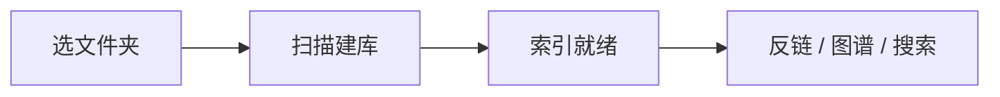

# 代码块与数学公式

## 带子语言的高亮

围栏后写语言名，就能拿到该语言的语法高亮；不写则只做原样保留。

```js
export function summarize(docs) {
  const list = [...docs.values()]
  return list
    .filter((d) => d.outgoing.length > 0)
    .map((d) => ({ path: d.path, out: d.outgoing.length, in: d.backlinks.length }))
    .sort((a, b) => b.in - a.in)
}
```

```python
def top_hubs(docs):
    return sorted(docs, key=lambda d: -len(d["backlinks"]))[:10]
```

写代码示例时如果把双链语法放进围栏里，它不会被当成真链接抽走：

```markdown
[[某个页面]] 与 #某个标签 在这里只是示例文字
```

## 数学

行内：质能方程 $E = mc^2$，以及带下标的 $x_i + y_i \le 1$。

块级独立成行，可编号也可对齐：

$$
\begin{aligned}
\nabla \cdot \mathbf{E} &= \frac{\rho}{\varepsilon_0} \\
\nabla \times \mathbf{B} &= \mu_0\left(\mathbf{J} + \varepsilon_0 \frac{\partial \mathbf{E}}{\partial t}\right)
\end{aligned}
$$

公式在文档里是可编辑的对象，不是图片：双击进源码态改 LaTeX，渲染即时更新。
Word 里的公式（OMML）导入会转成 LaTeX，导出方向同理，两端都能落地。

## 上下标与删除线

化学式用下标 $H_2 O$ 或直接写 `H~2~O`；引用旧结论用 ~~已废弃的写法~~。

## 图示

流程图 / 时序图交给 mermaid：



想看这套语法在正文里怎么混排，接着读 [[tags-frontmatter]]。
