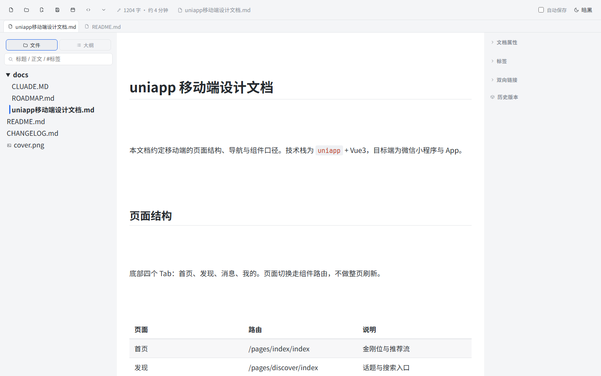

# 欢迎来到 NoteLume

这是一个跑在浏览器里的试用实例：本地文件夹就是知识库，全部文档都是标准 GFM Markdown，
与 Typora / Obsidian 完全兼容——没有数据库，也没有私有格式。

从这篇首页出发，三条链路已经预先连好，右侧「双向链接」与工具条「更多 → 知识图谱」打开就有数据：

- [[wiki-links]] —— 双链、锚点跳转与引用
- [[tables-tasks]] —— 表格、任务列表与折叠
- [[code-math]] —— 代码块高亮、行内与块级公式
- 进阶：[[tags-frontmatter]] 看多级标签与文档属性；[[空白页]] 是一篇空文档，用来试「新建后写什么」

想验证「点击不存在的链接会自动新建」，就点这个：[[尚未存在的页面]]。

## 在这里可以做什么

1. 左栏选文件、`Ctrl+N` 新建、`Ctrl+S` 保存；沙盒模式下改动只留在你自己的临时工作区
2. 选中文字加高亮；`Ctrl+F` 文内查找，`Ctrl+Shift+F` 全库搜索
3. 右侧检查器看反链 / 标签 / 历史版本（快照），`Ctrl+Shift+E` 走单双栏切换
4. `Ctrl+E` 切源码模式，对照渲染结果与原始 Markdown

## 语法快速一览

| 能力 | 写法 | 在本实例的状态 |
| --- | --- | --- |
| 双向链接 | 两个方括号包页面名 | 已进索引 |
| 标签 | 井号接标签名 | 计数与筛选可用 |
| 任务列表 | 短横线加方括号 | 可直接点选 |
| 行内公式 | 两个美元符号夹式子 | KaTeX 渲染 |

行内公式 $E = mc^2$ 与下面这块：

$$
\sum_{i=1}^{n} i = \frac{n(n+1)}{2}
$$

> 引用块：NoteLume 的目标是「打开就能用」，而不是先配置半小时。

~~删除线~~、**加粗**、*斜体*、`行内代码` 都在；鼠标悬停链接可预览目标首屏。

本页的标签（写在一行之首的井号会被当成标题，所以得落在句子里）：#开始/首页 #开始/演示
